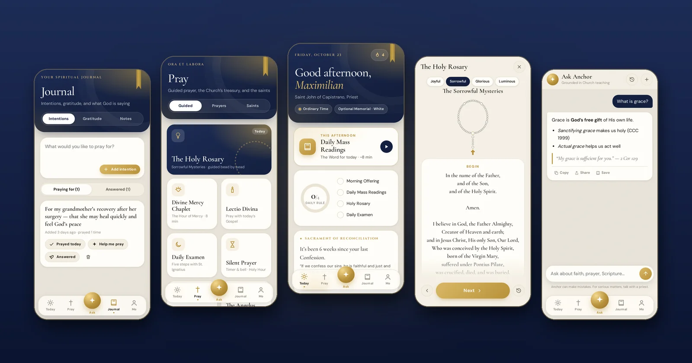
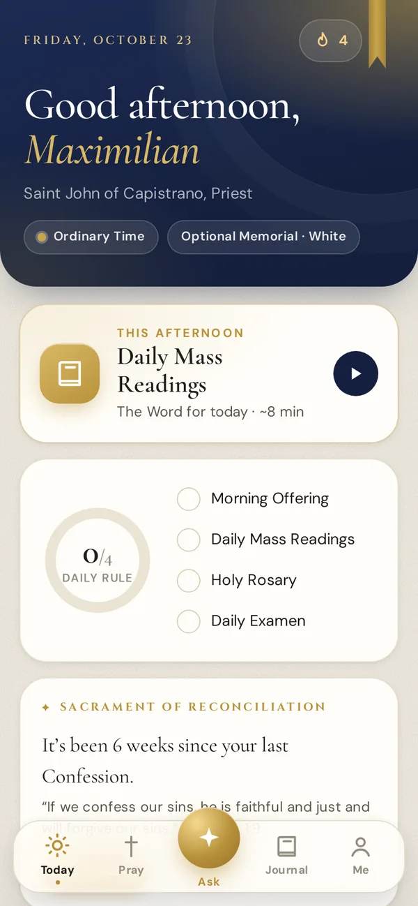
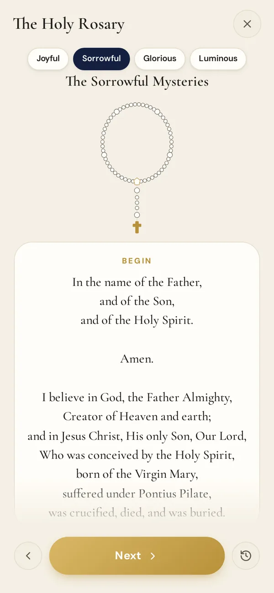
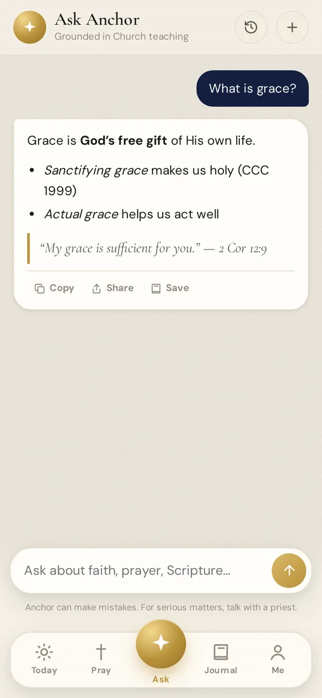
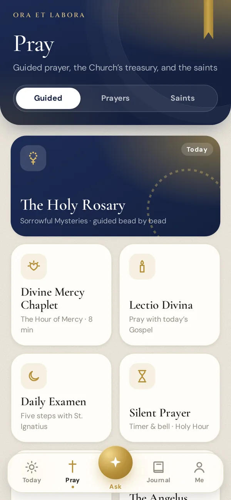
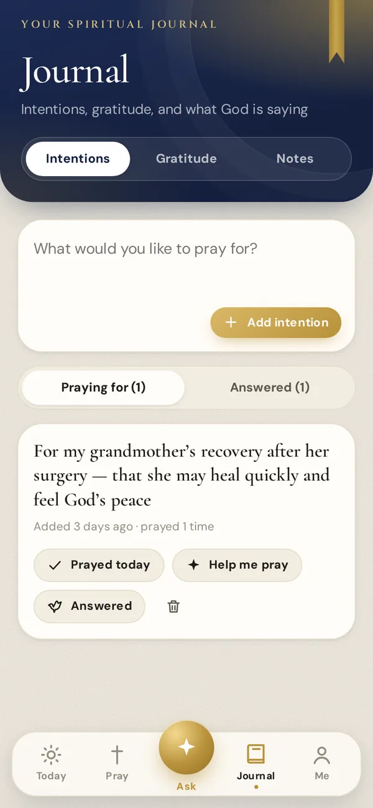
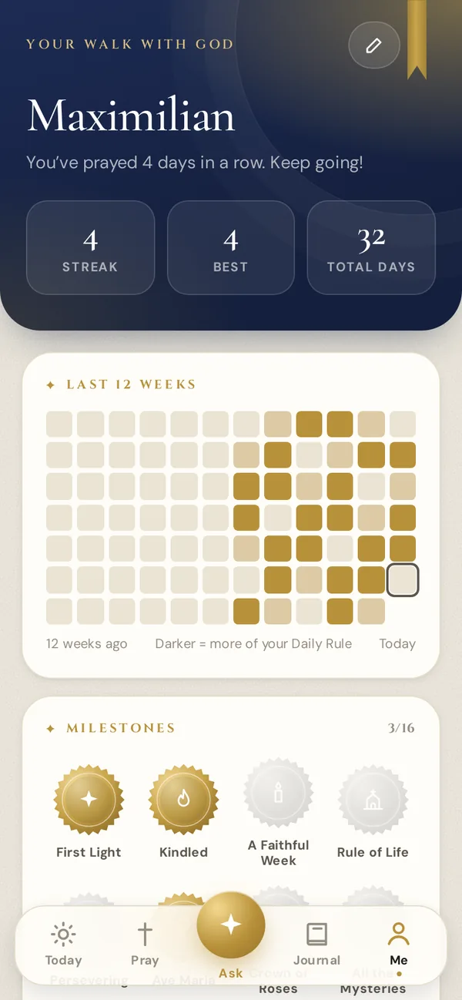
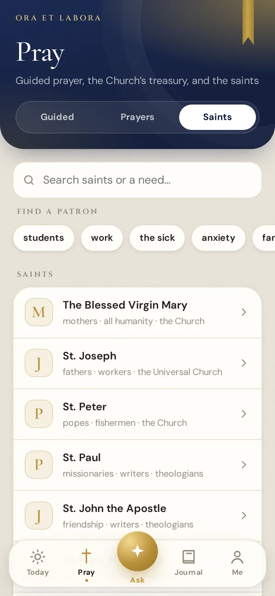
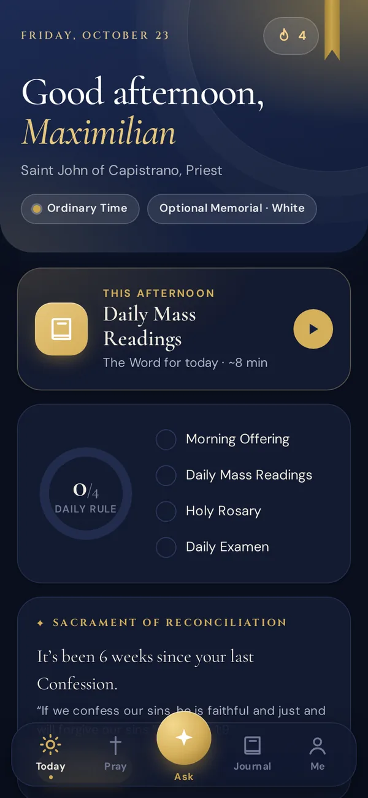
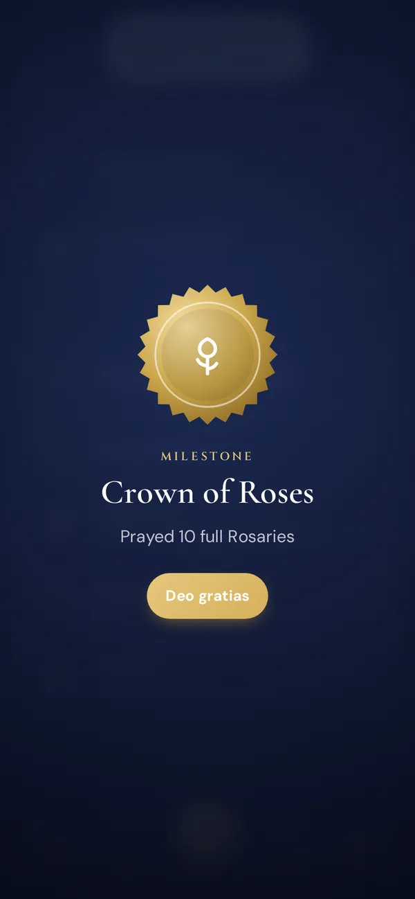

<div align="center">


# Anchor

**A daily Catholic prayer companion**

Pray the Rosary bead by bead, read today's Mass readings, meet the saints,<br>and keep a journal of everything you're bringing to God.

**[Open Anchor →](https://candycain5432.github.io/Anchor/)**

<sub>Free · No account · Works offline · Your data stays on your device</sub>

<br>



*“We have this as a sure and steadfast anchor of the soul.” — Hebrews 6:19*

</div>

---

## Features

<table>
<tr>
<td width="33%" valign="top"></td>
<td width="33%" valign="top"></td>
<td width="33%" valign="top"></td>
</tr>
<tr>
<td valign="top"><b>Today</b><br>The liturgical day and its vestment color, a prayer suited to the hour, your Daily Rule, the Verse of the Day, a short reflection, the Saint of the Day, the readings and this week's feasts.</td>
<td valign="top"><b>Guided Rosary</b><br>Every prayer on screen, bead by bead, with the mystery and its fruit, haptics, and resume where you left off. The Divine Mercy Chaplet works the same way.</td>
<td valign="top"><b>Ask Anchor</b><br>Questions about the faith, answered in line with Church teaching, with citations to Scripture and the Catechism. Ask about a specific reading or saint in one tap.</td>
</tr>
<tr>
<td valign="top"></td>
<td valign="top"></td>
<td valign="top"></td>
</tr>
<tr>
<td valign="top"><b>Pray</b><br>Lectio Divina with today's Gospel, the Daily Examen, Confession prep, a Silent Prayer / Holy Hour timer, the Angelus, novenas, and a searchable prayer library with favorites.</td>
<td valign="top"><b>Journal</b><br>Keep prayer intentions, pray for them each day, and mark them answered. Write down three gifts from the day, and keep notes from Lectio. “Help me pray” drafts a prayer for an intention.</td>
<td valign="top"><b>Your walk with God</b><br>Streaks that count prayer, not app opens. A 12-week heatmap, milestones to earn, reminders at times you choose, and backup / restore.</td>
</tr>
<tr>
<td valign="top"></td>
<td valign="top"></td>
<td valign="top"></td>
</tr>
<tr>
<td valign="top"><b>Saints</b><br>Sixty saints with their stories and patronages. Find a patron for students, the sick, travel, family and more, and ask for their intercession.</td>
<td valign="top"><b>Light & dark</b><br>Follows your system, or set it yourself. Four text sizes. The accent color changes with the liturgical season.</td>
<td valign="top"><b>Milestones</b><br>Gold seals for faithfulness: your first Rosary, a week of prayer, a finished novena, a prayer answered.</td>
</tr>
</table>

## Install it

Anchor is a web app, so there's no app store. Add it to your home screen and it works like any other app, offline included.

- **iPhone / iPad**: open the link in Safari, tap **Share**, then **Add to Home Screen**. You need to do this before you can turn on reminders.
- **Android**: open the link in Chrome and tap **Install app** (or ⋮ → **Add to Home screen**).
- **Desktop**: in Chrome or Edge, click the install icon in the address bar.

## Privacy

Your journal, intentions, chats, streaks and settings live **only on your device** (`localStorage`). There's no account. The server keeps no logs, and it only sees what it needs to answer:

- When you ask Anchor a question, it gets your message and the last few turns of that conversation.
- If you turn on reminders, it stores your push subscription, timezone and chosen times.

The full policy is in the app under **Me → Privacy Policy**.

---

## How it's built

No build step: plain HTML, CSS and native ES modules, hosted on GitHub Pages. The backend is [Project-Veritas](https://github.com/candycain5432/Project-Veritas), an Express server on Render. It handles Ask Anchor (OpenAI), daily reflections and push reminders.

```
index.html          app shell
css/tokens.css      colors, themes, liturgical colors, type scale
css/app.css         components
js/app.js           boot, router, theme, service worker
js/store.js         localStorage wrapper + migration from pre-9.0 keys
js/api.js           every network call (calendar, readings, verse, backend, Wikipedia, Overpass)
js/icons.js         line icon set (used everywhere instead of emoji)
js/practices.js     Daily Rule, log, streaks, milestones, launching practices
js/screens/         today, pray, ask, journal, me, saints
js/features/        beads (Rosary/Chaplet), lectio, timer, examen, novena, reader, share-card
js/data/            prayers, novenas, saints
service-worker.js   offline cache, push, notification deep links
icons/              app icons; regenerate with tools/make-icons.mjs
screenshots/        images for this README
```

Data sources:
- **Liturgical calendar**: [Catholic Readings API](https://github.com/cpbjr/catholic-readings-api).
- **Reading texts**: [bible-api.com](https://bible-api.com), Douay-Rheims translation.
- **Verse of the day**: bible.org.
- **Saint biographies**: Wikipedia.
- **Nearby churches**: OpenStreetMap.

## Develop

```sh
python -m http.server 8000     # then open http://localhost:8000
```

To point the app at a local backend, run this in the browser console:

```js
localStorage['anchor:apiBase'] = '"http://localhost:3000"'
```

**When you ship changes**, bump `CACHE_NAME` in `service-worker.js` and `VERSION` in `js/screens/me.js`. If you add a JS or CSS file, add it to `STATIC_ASSETS` too.

Console helpers: `Anchor.forceUpdate()`, `Anchor.clearCaches()`, `Anchor.listCaches()`.

Deep links (used by notifications and home-screen shortcuts): `./?open=rosary|chaplet|readings|examen|lectio|confession|ask|journal|me`.

## Moving to a custom domain

Every path in the app is relative, so it works the same at `example.com/` as at `candycain5432.github.io/Anchor/`. To switch:

1. **DNS** at your registrar:
   - Subdomain (e.g. `anchor.example.com`): one `CNAME` record → `candycain5432.github.io`
   - Apex (e.g. `example.com`): `A` records → `185.199.108.153`, `185.199.109.153`, `185.199.110.153`, `185.199.111.153`
     (and optionally `AAAA` → `2606:50c0:8000::153`, `2606:50c0:8001::153`, `2606:50c0:8002::153`, `2606:50c0:8003::153`), plus a `CNAME` for `www` → `candycain5432.github.io`
2. **GitHub** → repo Settings → Pages → *Custom domain*: enter it and save (this commits a `CNAME` file — pull it). Once the certificate is issued, tick **Enforce HTTPS**.
3. **Links**: replace the old URL in the link-preview tags in `index.html` and the links in this README:
   ```sh
   sed -i 's#https://candycain5432.github.io/Anchor/#https://YOUR-DOMAIN/#g' index.html README.md
   ```
4. **Analytics**: update the stream URL in Google Analytics (Admin → Data streams). Optional — data keeps flowing either way.

Nothing changes on the backend (CORS is open to any origin).

**Heads-up for existing users:** a new domain is a new origin, so the browser treats it as a different site. GitHub redirects the old address automatically, but localStorage (streaks, journal, chats) and push subscriptions stay with the old origin. Before switching, ask people to use **Me → Back up**, then **Restore a backup** on the new domain, and to re-enable reminders and re-add the app to their home screen.

---

<div align="center">
<sub>Made by <a href="https://github.com/candycain5432">William Cain</a> · <a href="mailto:contact@williamcain.net">contact@williamcain.net</a><br><i>Ad maiorem Dei gloriam</i></sub>
</div>
