<div align="center">


# Anchor

**A daily Catholic prayer companion**

Pray the Rosary bead by bead, read today's Mass readings, meet the saints,<br>and keep a journal of everything you're bringing to God.

**[Open Anchor →](https://faithanchor.net/)**

<sub>Free · No account · Works offline · Your data stays on your device</sub>

<br>

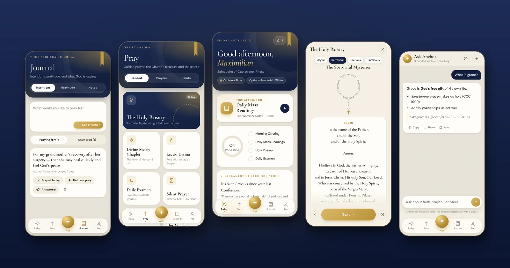

*“We have this as a sure and steadfast anchor of the soul.” — Hebrews 6:19*

</div>

---

## Features

<table>
<tr>
<td width="33%" valign="top">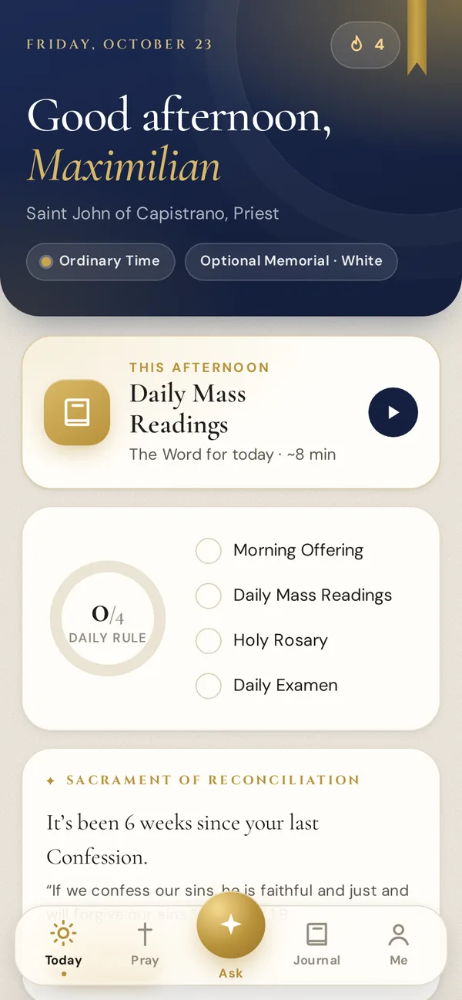</td>
<td width="33%" valign="top">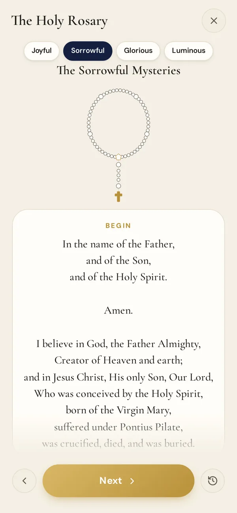</td>
<td width="33%" valign="top">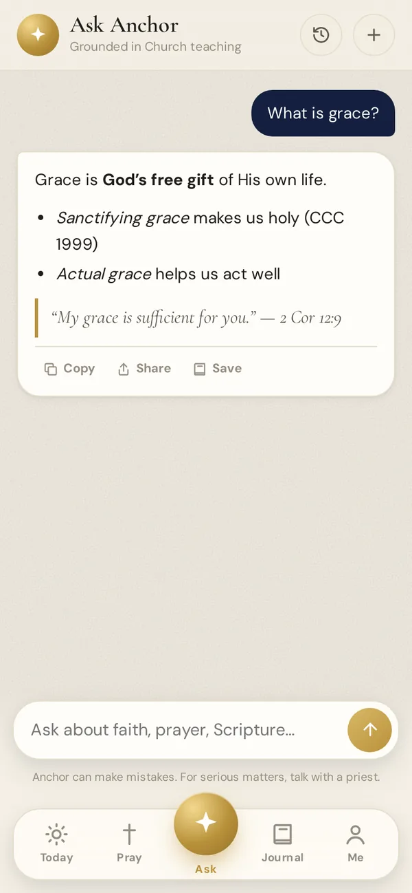</td>
</tr>
<tr>
<td valign="top"><b>Today</b><br>The liturgical day and its vestment color, a prayer suited to the hour, your Daily Rule, the Verse of the Day, a short reflection, the Saint of the Day, the readings and this week's feasts.</td>
<td valign="top"><b>Guided Rosary</b><br>Every prayer on screen, bead by bead, with the mystery and its fruit, haptics, and resume where you left off. The Divine Mercy Chaplet works the same way.</td>
<td valign="top"><b>Ask Anchor</b><br>Questions about the faith, answered in line with Church teaching, with citations to Scripture and the Catechism. Ask about a specific reading or saint in one tap.</td>
</tr>
<tr>
<td valign="top">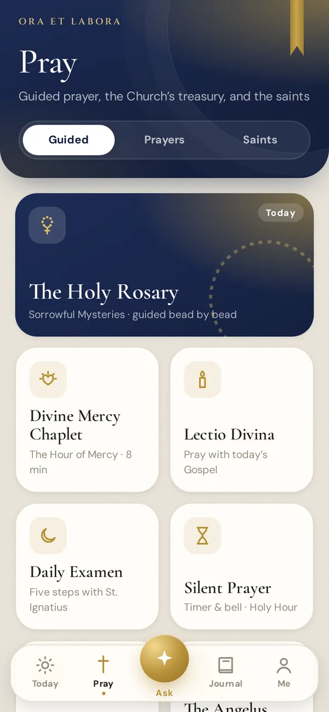</td>
<td valign="top">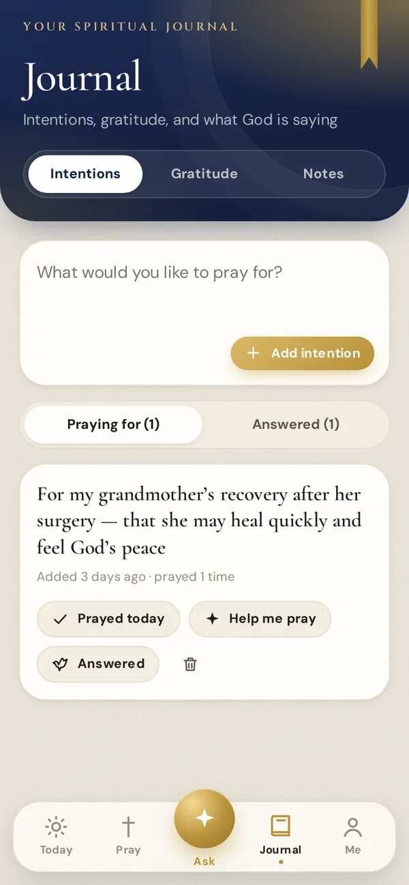</td>
<td valign="top">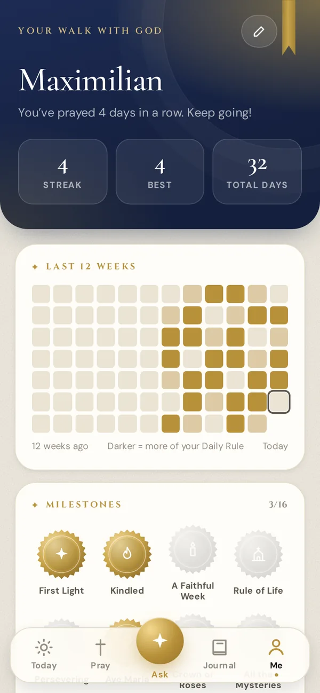</td>
</tr>
<tr>
<td valign="top"><b>Pray</b><br>Lectio Divina with today's Gospel, the Daily Examen, Confession prep, a Silent Prayer / Holy Hour timer, the Angelus, novenas, and a searchable prayer library with favorites.</td>
<td valign="top"><b>Journal</b><br>Keep prayer intentions, pray for them each day, and mark them answered. Write down three gifts from the day, and keep notes from Lectio. “Help me pray” drafts a prayer for an intention.</td>
<td valign="top"><b>Your walk with God</b><br>Streaks that count prayer, not app opens. A 12-week heatmap, milestones to earn, reminders at times you choose, and backup / restore.</td>
</tr>
<tr>
<td valign="top">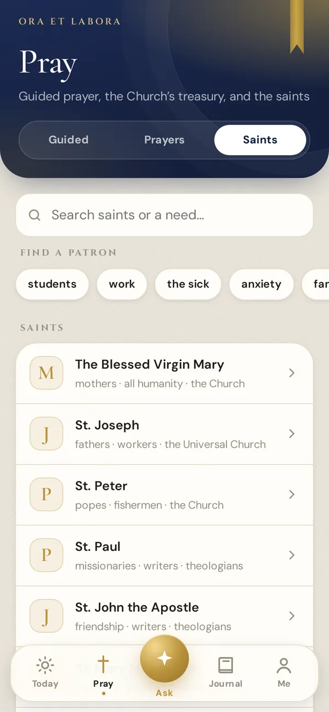</td>
<td valign="top">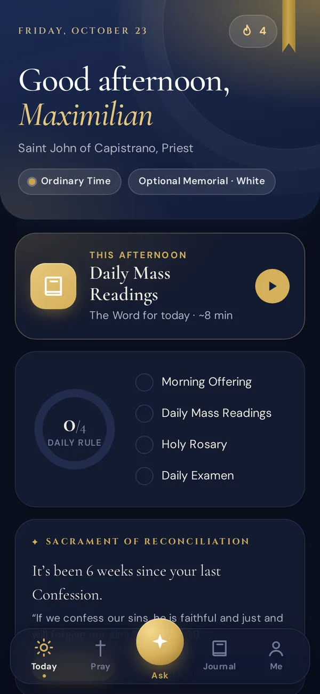</td>
<td valign="top">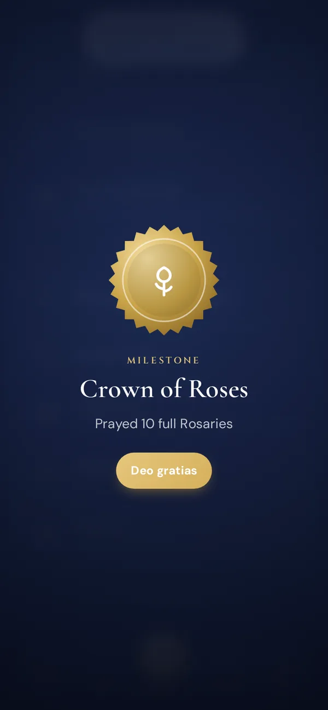</td>
</tr>
<tr>
<td valign="top"><b>Saints</b><br>Sixty saints with their stories and patronages. Find a patron for students, the sick, travel, family and more, and ask for their intercession.</td>
<td valign="top"><b>Light & dark</b><br>Follows your system, or set it yourself. Four text sizes. The accent color changes with the liturgical season.</td>
<td valign="top"><b>Milestones</b><br>Gold seals for faithfulness: your first Rosary, a week of prayer, a finished novena, a prayer answered.</td>
</tr>
</table>

## Install it

Anchor is a web app, so there's no app store. Add it to your home screen and it works like any other app, offline included.

- **iPhone / iPad**: open the link in Safari, tap **Share**, then **Add to Home Screen**. You need to do this before you can turn on reminders.
- **Android**: open the link in Chrome and tap **Install app** (or ⋮ → **Add to Home screen**).
- **Desktop**: in Chrome or Edge, click the install icon in the address bar. In Safari on a Mac, File → **Add to Dock**.
- **Opened from Instagram, Facebook or TikTok?** Their built-in browsers can't install apps. Tap ••• / ⋮ → **Open in browser** first.

<table>
<tr>
<td align="center">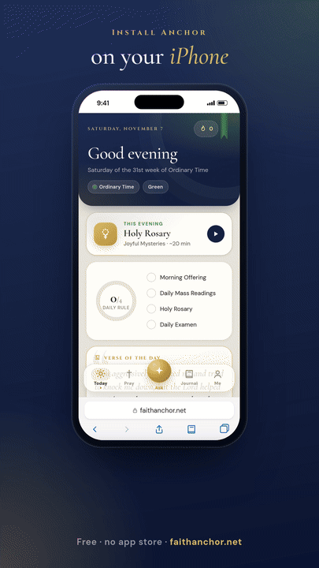<br><sub>iPhone (Safari)</sub></td>
<td align="center">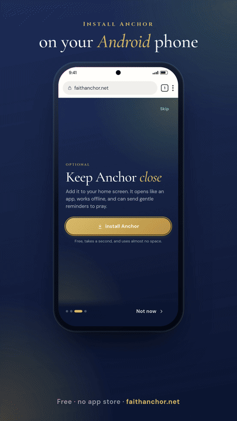<br><sub>Android (Chrome)</sub></td>
</tr>
</table>

The same steps are in the app under **Me → About → Install Anchor**, and in the [FAQ](https://faithanchor.net/faq.html).
Vertical MP4 versions for social posts are in `media/` (`install-iphone.mp4`, `install-android.mp4`).

## Privacy

Your journal, intentions, chats, streaks and settings live **only on your device** (`localStorage`). There's no account. The server keeps no logs, and it only sees what it needs to answer:

- When you ask Anchor a question, it gets your message, up to the last 10 turns of that conversation, and the reading or saint if you used "Ask about this".
- "Help me pray" sends only that intention's text.
- If you turn on reminders, it stores your push subscription, timezone and chosen times.

The full policy is at [faithanchor.net/privacy.html](https://faithanchor.net/privacy.html) and in the app under **Me → About → Privacy Policy**.

---

## How it's built

No build step: plain HTML, CSS and native ES modules, hosted on GitHub Pages at faithanchor.net. The backend is [Project-Veritas](https://github.com/candycain5432/Project-Veritas), an Express server on Render. It handles Ask Anchor (OpenAI), daily reflections and push reminders.

```
index.html          app shell
css/tokens.css      colors, themes, liturgical colors, type scale
css/app.css         components; responsive: phone < 600px, tablet, desktop sidebar ≥ 900px, two columns ≥ 1100px
css/doc.css         long-form text (FAQ, privacy) in the app and on the pages
js/app.js           boot, router, theme, service worker, in-app browser banner
js/onboarding.js    first-run welcome: privacy → about the maker → install (browser only) → where to begin
js/install.js       install instructions per device, beforeinstallprompt, Share Anchor, in-app browser detection
js/nudges.js        one-time asks: reminders after the first prayer, Ko-fi once Anchor has been used for a day
js/donate.js        Ko-fi link, goal text and the pop-up
js/docs.js          opens faq.html / privacy.html in a sheet
js/analytics.js     Google Analytics: virtual page views, navigation source, events, user properties
js/store.js         localStorage wrapper + migration from pre-9.0 keys
js/api.js           every network call (calendar, readings, verse, backend, Wikipedia, Overpass)
js/icons.js         line icon set (used everywhere instead of emoji)
js/practices.js     Daily Rule, log, streaks, milestones, launching practices
js/screens/         today, pray, ask, journal, me, saints
js/features/        beads (Rosary/Chaplet), lectio, timer, examen, novena, reader, share-card
js/data/            prayers, novenas, saints
service-worker.js   offline cache, push, notification deep links
faq.html            FAQ (standalone page, also shown in Me → About)
privacy.html        Privacy Policy (same)
icons/              app icons; regenerate with tools/make-icons.mjs
screenshots/        images for this README
```

Data sources:
- **Liturgical calendar**: [Catholic Readings API](https://github.com/cpbjr/catholic-readings-api).
- **Reading texts**: [bible-api.com](https://bible-api.com), Douay-Rheims translation.
- **Verse of the day**: bible.org.
- **Saint biographies**: Wikipedia.
- **Nearby churches**: OpenStreetMap.

## Analytics

Google Analytics 4 (`G-41V16QZ641`, loaded in the `<head>` of `index.html`, `faq.html` and `privacy.html`).
Anchor is a single page, so `js/analytics.js` reports every screen, tab and
sheet as its own **virtual page**, which makes GA's *Pages and screens* report and *Path exploration* show what's
used and how people move around. Only fixed names, ids and counts are sent: never journal or chat text, names,
search words or locations.

| Page path | What it is |
|---|---|
| `/today`, `/ask`, `/me` | Main screens |
| `/pray`, `/pray/prayers`, `/pray/saints` · `/journal`, `/journal/gratitude`, `/journal/notes` | Screens and their tabs |
| `/pray/rosary`, `/pray/chaplet`, `/pray/lectio-divina`, `/pray/examen`, `/pray/confession`, `/pray/silent-prayer` | Guided practices |
| `/readings` · `/prayer/<name>` · `/saint/<name>` · `/novena/<id>` (`/start`) | Readings, prayers, saints, novenas |
| `/welcome/welcome` → `/about` → `/install` → `/begin` | Onboarding steps |
| `/ask/notice`, `/ask/history`, `/install`, `/faq`, `/privacy`, `/me/name`, `/me/milestone/<id>`, `/journal/note`, … | Other sheets |
| `/prompt/reminders`, `/prompt/donate` | One-time asks |
| `/sheet/<title>` | Any sheet without a name of its own |

Every `page_view` carries **`previous_page`** (where they came from; `(entrance)` for the first) and **`nav_source`**:
`launch`, `tab_bar`, `sidebar`, `screen_tab`, `deep_link` (notification or home-screen shortcut opening the app),
`notification` (tapped while the app was open), `onboarding`, or `in_app` (a card, button or link inside the app).

| Event | Parameters |
|---|---|
| `practice_start`, `practice_completed` | `practice` |
| `chat_sent` | `context` (reading, saint…), `source` (`typed`, `starter`, `ask_about`, `retry`), `turn` |
| `chat_new` | `previous_turns` |
| `journal_action` | `item` (`intention`, `gratitude`, `note`), `action` (`add`, `edit`, `delete`, `prayed`, `answered`, `help_me_pray`), `count` |
| `favorite` | `item_type` (`prayer`, `saint`), `item_name`, `action` |
| `library_search` | `search_type` (`prayers`, `saints`), `has_results`, `results` |
| `patron_filter` | `patron` |
| `setting_change` | `setting` (`theme`, `text_size`, `daily_rule`, `reminder_times`, `confession_reminder`, `name`), `value` |
| `data_action` | `action` (`backup`, `restore`, `erase`) |
| `find_churches` | `results` |
| `scroll` | `percent_scrolled` (90, inside the current screen or sheet) |
| `exception` | `description` (JavaScript error message) |
| also | `milestone`, `share`, `share_app`, `doc_open`, `install_prompt`, `install_help`, `app_installed`, `inapp_browser`, `onboarding_start`/`_complete`, `reminder_ask`, `reminders_enabled`/`_disabled`, `donate_popup`, `donate_click`, `ai_limit_hit` |

User properties: `launch_mode` (installed / browser), `layout` (phone / tablet / desktop), `theme`, `text_size`,
`reminders`, `daily_rule_size`.

**Optional setup in GA** (Admin), for cleaner reports:

1. **Data streams → your web stream → Enhanced measurement → ⚙︎**: turn **off** *Page changes based on browser
   history events* (the app sends its own page views; leaving it on adds stray ones). Keep outbound clicks on.
2. **Custom definitions → Create custom dimension** for each parameter you want in reports. Event-scoped:
   `previous_page`, `nav_source`, `practice`, `source`, `context`, `item`, `action`, `item_type`, `item_name`,
   `setting`, `value`, `search_type`, `has_results`, `patron`, `from`, `method`, `outcome`, `step`, `begin`.
   User-scoped: `launch_mode`, `layout`, `theme`, `text_size`, `reminders`, `daily_rule_size`.
   (Custom metrics, optional: `turn`, `results`, `count`.) Dimensions only fill in from the day they're created.
3. **Data filters → Developer traffic → Active.** Visits from anywhere other than faithanchor.net (localhost, your
   home network) are sent with `debug_mode` (set in `js/analytics.js`), so this keeps your own testing out of the numbers.

**Where to look:** *Reports → Engagement → Pages and screens* (by *Page path*) for what's used;
*Explore → Path exploration* (start from `page_view` → `/today`) for how people move around; *Explore → Free form*
with `nav_source` or `previous_page` for how they reach a page. To watch events live, open the live app with
`?ga_debug=1` and use *Admin → DebugView*.

## Develop

```sh
python -m http.server 8000     # then open http://localhost:8000
```

To point the app at a local backend, run this in the browser console:

```js
localStorage['anchor:apiBase'] = '"http://localhost:3000"'
```

**When you ship changes**, bump `CACHE_NAME` in `service-worker.js` and `VERSION` in `js/screens/me.js`. If you add a JS or CSS file, add it to `STATIC_ASSETS` too.

Console helpers: `Anchor.forceUpdate()`, `Anchor.clearCaches()`, `Anchor.listCaches()`.

Deep links (used by notifications and home-screen shortcuts): `./?open=rosary|chaplet|readings|examen|lectio|confession|ask|journal|me`.

## Hosting

The app is served by GitHub Pages at **[faithanchor.net](https://faithanchor.net/)** (see `CNAME`). The old `candycain5432.github.io/Anchor/` address redirects there. Every path in the app is relative, so it would work the same under any domain or sub-path.

---

<div align="center">
<sub>Made by <a href="https://williamcain.net">William Cain</a> · <a href="https://github.com/candycain5432">GitHub</a> · <a href="mailto:contact@williamcain.net">contact@williamcain.net</a><br><i>Ad maiorem Dei gloriam</i></sub>
</div>
